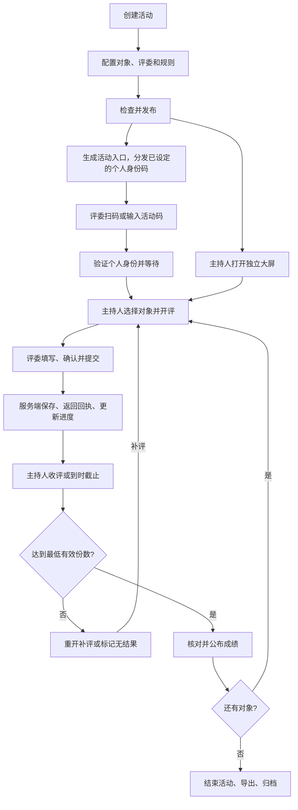
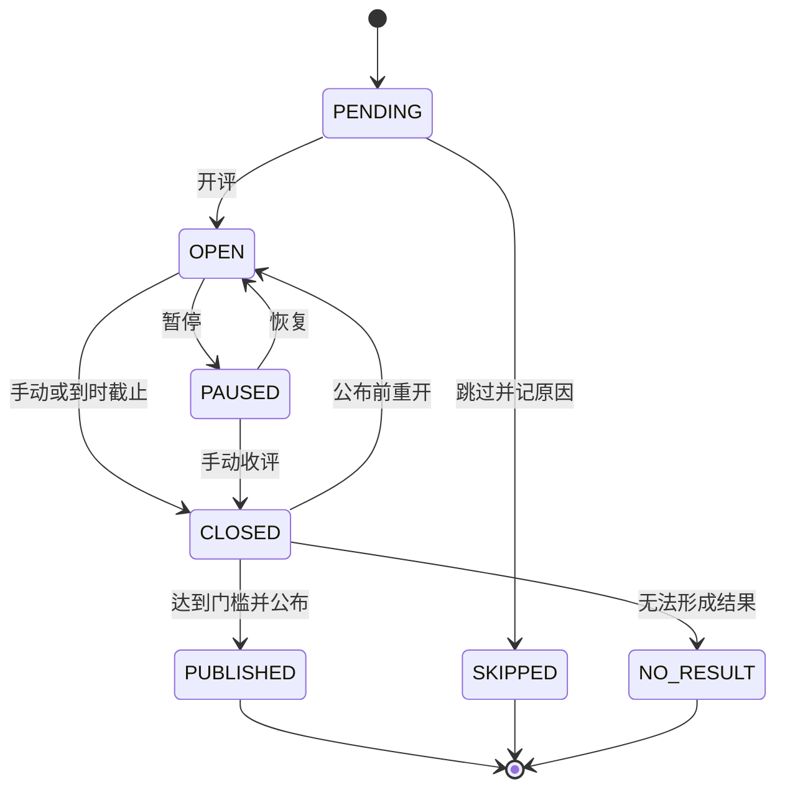
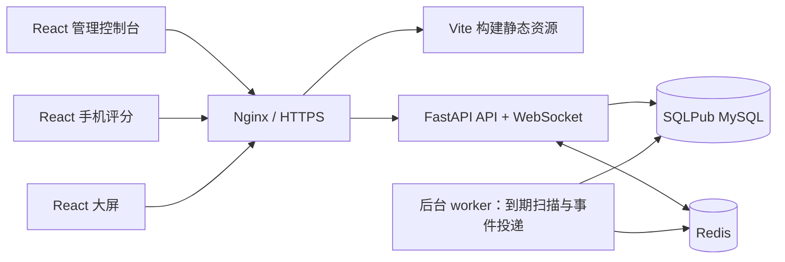

# 在线打分系统：产品需求与架构设计

版本：V1.1 需求设计稿  
日期：2026-10-10  
场景：固定评委参与的比赛、答辩、项目评审、路演等现场活动  
技术约束：前端 React + Vite + TypeScript，后端 FastAPI，数据库 MySQL（InnoDB）

> 已确认采用固定评委打分，先开发通用版；个人身份码支持管理页面自动生成或手动设置。首期使用用户现有 SQLPub 免费 MySQL 实例，按用户提供的总连接数 30 个、总存储量 500MB 规划，不套用官网新购套餐额度。单位五位短号、人员库与统一登录列入后续增强。其余具体规则为建议默认方案；性能和保留期限尚未经过实测或最终确认。

## 1. 产品定位

建立“电脑创建与控制活动、现场大屏展示、评委手机评分”的在线系统。主持人统一控制评分顺序，评委通过二维码或链接进入活动，使用独立身份提交分数，系统自动计算、公布和导出成绩。

保留两个用户入口：

| 入口 | 用户 | 功能 |
| --- | --- | --- |
| 电脑端 | 主办方、主持人 | 活动设置、名单管理、二维码生成、开评与收评、大屏展示、成绩导出 |
| 手机端 | 固定评委 | 加入活动、身份验证、等待评分、填写分数、提交确认、本人记录 |

电脑端内部拆为“管理控制台”和“独立只读大屏”。主持人操作笔记本，大屏投影单独页面，避免把管理按钮、身份码和未公开成绩投到现场。

产品目标：主持人可独立完成活动全过程；评委不用安装 App；成绩可追溯；重复点击和断线重连不重复计分；收到成功回执意味着服务端已持久化。

## 2. 首版范围与默认规则

### 2.1 P0：首版必须实现

- 主办方账号登录，活动创建、复制、归档。
- 多个参评对象，一个评分阶段，统一评分模板。
- 固定评委名单，所有评委默认为全部对象评分。
- 公共活动二维码、链接、活动码，每位评委独立身份码，管理页面支持自动生成、手动设置及重置。
- 单项总分、多维度加权评分；平均分、去最高最低分后平均。
- 顺序开评、暂停、恢复、手动收评、倒计时自动截止。
- 手机草稿、提交确认、开放期改分、回执与本人历史。
- 大屏等待、实时进度、已公布成绩和排行榜。
- CSV 导出、操作审计、断线恢复、基础监控。

### 2.2 P1：后续增强

多阶段比赛与晋级、不同对象分配不同评委组、评委回避或权重、多主持人协作、已公布成绩的纠错审批与版本公告、批量导入、更多大屏主题、实时公开均分、自定义同分决胜规则、评语和分析报告。

单位版在通用版闭环稳定后迭代，不作为 P0 开发或验收前提：

| 增强项 | 后续设计方向 |
| --- | --- |
| 单位五位短号 | 增加单位内唯一的人员短号，按字符串保存并保留前导零；通用版评委编号不强制五位 |
| 单位身份验证 | 短号用于定位人员，配合活动专属验证码或管理员首次加入审核；如需仅凭五位码加入，作为显式启用的弱验证模式单独评审 |
| 单位人员库 | 姓名、短号、部门及启停状态，支持批量导入和跨活动选取；活动名单保留发布时快照 |
| 统一登录 | 按单位实际条件接入 SSO 或内部身份系统，外部身份映射到内部人员 ID |
| 单位展示与权限 | 单位名称、标识、术语配置，以及按需增加部门和管理员权限范围 |
| 单位部署 | 按实际网络条件适配内网 HTTPS、单位自有 MySQL 和备份体系，复用通用评分核心 |

首版内部以不可变评委 ID 关联评分，不将编号或身份码作为评分外键，为后续人员映射留出空间；暂不实现单位人员表、短号专用登录流程和统一登录接口。

暂不包含观众匿名投票、评委与观众混合计分、原生 App、微信小程序、支付及 AI 打分。

### 2.3 默认方案

| 项目 | 默认值 |
| --- | --- |
| 单场规模 | 3～50 名评委，1～100 个参评对象 |
| 同时评分 | 每场最多一个对象处于评分中或暂停状态 |
| 评分阶段 | 单阶段，每个对象一个评分任务 |
| 手机访问 | 公网 HTTPS，现场 Wi-Fi 或移动网络 |
| 成绩公开 | 评分时只公开进度，主持人公布后展示分数 |
| 身份方式 | 固定名单 + 活动内个人身份码，后台自动生成或手动设置，无须注册评委账号 |
| 首期部署容量 | 先验收单场活动；SQLPub 实例总连接数 30 个、总存储量 500MB |
| 输入与结果精度 | 输入默认 1 位小数，最终成绩 2 位小数 |
| 改分 | 开放期允许，保留历史；公布后冻结 |
| 同分 | 并列，采用 1、2、2、4 排名 |

活动发布时冻结名单和评分规则。需要不同评分标准的环节，首版建立独立活动，不自动合成跨活动排名。

## 3. 角色与权限

| 功能或数据 | 主办方/主持人 | 评委 | 大屏观看者 |
| --- | --- | --- | --- |
| 配置活动、对象和评委 | 本人拥有的草稿活动 | 否 | 否 |
| 自动生成/手动设置/重置个人身份码 | 是，限本人活动且活动未结束 | 只使用自己的码 | 否 |
| 开评、暂停、收评、公布 | 是 | 否 | 否 |
| 提交或修改分数 | 不代替评委评分 | 仅本人，且任务开放 | 否 |
| 查看原始分和改分历史 | 是 | 仅本人 | 否 |
| 查看未公布汇总分 | 是 | 否 | 否 |
| 查看已公布成绩 | 是 | 是 | 是 |
| 导出完整明细和审计 | 是 | 否 | 否 |

首版由活动创建者兼任主持人。权限必须由后端逐接口、逐活动和逐 WebSocket 订阅校验；不能仅靠前端隐藏。

## 4. 业务概念

| 概念 | 含义 |
| --- | --- |
| 活动 Event | 独立评分活动，包含规则、评委、对象、结果 |
| 参评对象 Entry | 被评分的选手、团队、项目或节目 |
| 评分任务 ScoringRound | 一个对象的一次评分窗口，不代表多阶段比赛轮次 |
| 维度 Criterion | 内容质量、现场表现等评分项目 |
| 评分单 Ballot | 一位评委对一个任务的完整评分，所有维度一次提交 |
| 有效份数 n | 当前任务中有效评分单数量 |
| 应交份数 N | 任务开始时冻结的评委数量，断线不改变 N |
| 最低份数 K | 可以形成可公布结果所需的最低有效评分单数量 |
| 规则快照 | 发布时冻结的维度、权重、精度、算法、门槛等配置 |
| 结果快照 | 收评时保存的有效评分版本集合、计算过程和最终分 |

## 5. 主流程



二维码指向活动级入口。切换参评对象后手机自动跟随，不要求重新扫码。

## 6. 电脑端功能

### 6.1 活动管理与设置

活动列表展示名称、时间、状态、对象数量、完成进度，提供创建、复制、进入控制台、打开大屏、导出和归档。

| 配置组 | 字段与要求 |
| --- | --- |
| 基本信息 | 名称必填，1～80 字；简介、组织名称、计划时间可选 |
| 对象名单 | 编号、名称、简介、展示顺序；编号活动内唯一；至少一个对象 |
| 评委名单 | 姓名、编号；编号为字符串且活动内唯一；人数满足所选算法 |
| 评委凭证 | 每人独立身份码，支持自动生成、手动设置、重置；展示已设置状态及更新时间，不回显已保存明文 |
| 评分规则 | 模式、各维度满分与权重、输入步长、汇总算法、最低有效份数 |
| 过程规则 | 评分时长或不限时、开放期是否允许改分 |
| 大屏设置 | 标题、浅/深主题、是否显示公共二维码、排行榜数量 |

发布前校验名单、身份码格式与活动内唯一性、权重合计 100%、输入步长、有效份数门槛与算法人数；未设置身份码的评委在发布时自动生成。发布后冻结名单和评分规则；标题、主题等展示字段可改并留痕。凭证重置不属于名单变更，活动结束前仍可操作，但不得改变对应评委 ID、姓名、编号或历史评分归属。

复制活动仅复制配置和名单，不复制身份码（含手动设置的码）、会话、评分和结果。新活动回到草稿，由管理员重新设置或生成凭证。只有未产生评分的草稿可删除；有成绩的活动只归档。

### 6.2 链接与二维码

提供三种加入方式：扫描公共二维码、点击活动链接、在 `/join` 输入活动码。公共链接示例为 `/join/{public_code}`。

活动码用于定位活动，不能作为评分权限凭证。每位评委获得绑定活动及评委的独立身份码，在管理页面的“评委名单 → 身份码”中管理：

- 自动生成：默认生成 12 位易读随机字母数字，确保活动内不重复。
- 手动设置：首版接受 8～32 位 ASCII 字母数字，至少包含一个字母和一个数字；前后空白去除后统一为大写，设置和兑换使用相同规范化规则；不得与本活动其他评委重复。
- 编号与凭证分开：编号用于展示、排序和导出；身份码用于验证评分权限，不使用公开编号自动充当凭证。单位五位短号登录列为 P1。
- 发布前可设置或重新生成；发布后至活动结束前，修改统一走“重置身份码”，填写原因，原子更新凭证版本并撤销旧会话，保留评委 ID 和历史成绩。
- 明文仅在本次设置、生成或重置流程中提供复制和分发；离开后不支持找回，仅支持重置。数据库保存验证哈希及带服务端密钥的 HMAC 查找摘要，用于活动内唯一校验和兑换定位，不保存明文。

加入流程：预览活动 → 输入个人身份码 → 服务端验证 → 确认姓名/编号 → 建立评委会话 → 等待或评分。主持人通过现场私发或自行选定渠道分发个人身份码。

在本次凭证设置、生成或重置流程中，可生成私人邀请二维码作为快捷入口：身份凭证位于 URL fragment，页面读取后用 POST 兑换会话并清除地址栏凭证，不加载第三方分析脚本。离开该流程后不能从摘要还原私人邀请二维码，需要重置后重新分发。公共二维码、大屏和日志不得包含个人身份码。

每位评委默认一个有效手机会话。换设备由主持人重置身份码并撤销旧会话，再重新加入。刷新、短暂离线和后台切换不要求重新验证。活动结束后关闭新评分会话兑换，已有会话在有效期内只读。

### 6.3 主持人控制台

布局建议：左侧对象列表，中间当前任务及控制按钮，右侧评委状态，底部结果与日志入口。

- 开始评分：确认对象、应交人数、规则摘要和时长后开放。
- 暂停/恢复：暂停期间禁止提交、冻结剩余时长；恢复时重新计算截止时间。
- 查看进度：显示“已交 7 / 应交 9”；在线/离线与已交/未交独立展示，离线不撤销评分。
- 手动收评：未收齐时需填写原因；收评成功不等于可以公布。
- 重开补评：仅限尚未公布的 CLOSED 任务，填写原因，保留已有评分并设置新截止时间。
- 公布成绩：核对有效份数、缺交、剔除评分和最终分后确认。
- 切换对象：当前任务收评后可开下一个；未公布结果可留待稍后统一公布。
- 跳过/无结果：未开始任务可跳过；已开始但无法形成成绩的任务收评后标记无结果，均记录原因。
- 结束活动：不得有开放或暂停任务，全部对象应已公布、跳过或无结果。

主持人不能直接编辑评委分数。公布前发现错误，由主持人重开后对应评委本人改分。

### 6.4 独立大屏

路由 `/screen/{screen_id}`，使用可撤销的只读展示授权。授权只能读取展示数据，不能操作活动或读取原始个人评分。

| 模式 | 内容 |
| --- | --- |
| 等待 | 标题、提示语、公共二维码、活动码 |
| 评分中 | 对象编号和名称、已交/应交进度、倒计时 |
| 暂停 | 当前对象、暂停提示、冻结剩余时间 |
| 成绩 | 最终分、有效份数、算法、公布时间 |
| 排行榜 | 已公布对象名次与分数，未公布对象不参排 |
| 结束 | 最终排行榜、结束提示，可返回单对象成绩 |

主持人控制展示模式；默认开评切进度页、公布切成绩页、结束切榜单。优先适配 1920×1080、16:9，兼容投影分辨率，提供全屏按钮、二维码放大、连接状态、最后同步时间。

默认评分期间只实时展示进度，公布后实时展示成绩。逐笔公开均分列为 P1，避免改变固定评委评分的现场规则。

断线时保留最近一次确认画面，显示“连接中，数据可能延迟”；恢复后拉取快照。

## 7. 手机端功能

页面顺序：活动及本人身份 → 对象编号和名称 → 说明与倒计时 → 分数输入 → 个人总分预览 → 提交。

- 数字输入框配合加减按钮，触控区域建议至少 44px；滑块不作为唯一输入方式。
- 初始分数为空，不预填零或满分；零分有效，空值表示未填。
- 各维度显示满分、权重、说明，就地校验范围和精度。
- 提交前确认对象、维度分和总分，防止评分对象错误。
- 提交成功后显示服务端回执号、接收时间、有效版本。
- 未收到回执时显示“正在核验提交结果”，不能直接显示成功。
- 开放期允许改分时提供修改入口；新版本生效，仍只算一份。
- 草稿存本机，按活动、评委、任务、规则版本隔离；退出身份时清理。
- 断网保留草稿，恢复后先同步状态，再由评委确认提交；不后台自动补交过期草稿。
- 切换对象时保留旧草稿并提示，禁止将旧对象分数套入新对象。
- 本人历史展示服务端记录；不展示其他评委个人分，公布后可看对象最终成绩。

## 8. 评分算法与业务边界

### 8.1 单项与多维度

单项模式：评委输入 `0～M`，默认 M=100，个人百分制分数为 `S_j = 100 × 输入分 / M`。

多维度模式：维度满分为 M_i，权重 w_i 合计为 1，个人总分：

`S_j = 100 × Σ[(x_ji / M_i) × w_i]`

| 维度 | 满分 | 权重 | 输入 | 贡献 |
| --- | ---: | ---: | ---: | ---: |
| 内容质量 | 100 | 50% | 90 | 45 |
| 现场表现 | 10 | 30% | 8 | 24 |
| 创新性 | 20 | 20% | 18 | 18 |
| 合计 | — | 100% | — | 87 |

不对各维度贡献提前四舍五入。前端提供预览，后端重新计算权威结果。

### 8.2 汇总算法

首版评委等权。

| 算法 | 公式 | 要求 |
| --- | --- | --- |
| 平均分 | `F = ΣS_j / n` | n≥K |
| 去最高最低后平均 | `F = (ΣS_j-max(S_j)-min(S_j))/(n-2)` | n≥K 且 n≥5 |

去极值针对每位评委完整总分，不逐维度剔除。最高或最低有多份同分时仍各去一份；按“未舍入总分、评委编号”稳定排序，剔除首尾两位不同评委的评分，保留原始记录及剔除标记。

例：80、85、90、95、100 去除 80 和 100 后，结果为 90.00。人数不足时不自动改用其他算法。

### 8.3 有效份数与缺交

- 发布时配置 K：平均分默认 `max(1, ceil(0.8×N))`；去极值默认 `max(5, ceil(0.8×N))`；必须 K≤N。
- 正常收评建议等 n=N，提前收评允许 n<N，但记录原因。
- n<K 可以截止，不能公布分数；重开补评或标记无结果。
- n≥K 按实际有效评分计算，缺交不按零分计入；公示和导出标明“有效 n / 应交 N”。
- 缺席或断线不自动改变 N 或 K。发布后换评委或改规则，首版需建立新活动，避免暗改规则。
- 无结果和跳过对象不进入排名。

### 8.4 精度、改分与同分

- 用十进制数处理评分；默认输入步长 0.1，拒绝不合规精度。
- 服务端高精度 Decimal 运算，最终结果以 ROUND_HALF_UP 保留 2 位小数。
- 公布的两位小数成绩用于排名；同分并列，采用 1、2、2、4；同分列表按展示顺序排列，不改变名次。
- 改分新增版本并保留旧值，当前有效版本只有一个，已交人数不增加。
- 公布后成绩不可直接改写；多版本纠错流程列为 P1。
- 活动结束前显示“当前排名”，结束后显示“最终排名”。

## 9. 状态机与时间边界

活动状态：`DRAFT 草稿 → READY 已发布 → RUNNING 进行中 → FINISHED 已结束 → ARCHIVED 已归档`。

首次开评进入 RUNNING，结束后只读。归档影响列表分类，不物理删除数据。



首版 PUBLISHED、SKIPPED、NO_RESULT 为终态。提供复制出的演练活动用于彩排，不使用正式活动反复试操作。

评分、暂停、收评使用相同任务级并发控制。请求获得事务锁并进行校验时，必须任务为 OPEN 且 `server_now < deadline_at`；手机提前点击但请求校验时已截止，也算超时。

定时收评进程即使延迟，提交接口仍按截止时间拒绝迟交。暂停冻结剩余时间，恢复产生新截止时间；不限时 deadline_at 为 null。

同场最多一个 OPEN/PAUSED 任务。旧手机页面必须提交明确的任务 ID，服务端不能把旧请求转交给当前对象。

## 10. 页面与信息架构

| 路由 | 页面 |
| --- | --- |
| `/admin/login` | 管理员登录 |
| `/admin/events` | 活动列表 |
| `/admin/events/new` | 分步创建和发布检查 |
| `/admin/events/:id/settings` | 基本信息、对象、评委、规则 |
| `/admin/events/:id/control` | 主持人控制台 |
| `/admin/events/:id/results` | 成绩、日志、导出 |
| `/screen/:screenId` | 只读大屏 |
| `/join`、`/join/:publicCode` | 活动定位与评委身份验证 |
| `/judge/events/:id` | 等待、评分、回执 |
| `/judge/events/:id/history` | 本人记录和已公布结果 |

采用一个 React 工程，按 admin、screen、judge 分模块懒加载，手机端不加载后台表格等无关模块。

## 11. 总体技术架构

采用前后端分离的模块化单体。HTTP API 负责提交和控制，WebSocket 负责变化通知，MySQL（InnoDB）为权威数据源，Redis 负责跨进程广播和短期缓存。首期数据库连接用户现有 SQLPub 免费实例；前后端、Redis 和后台 worker 另行部署。



Vite 构建生成静态资源，由 Nginx 托管；vite preview 用于本地预览，不作为生产服务。[Vite 构建](https://vite.dev/guide/build)、[Vite 部署](https://vite.dev/guide/static-deploy.html)

FastAPI 支持 WebSocket，但官方内存连接列表示例仅适用于单进程。因此多 API worker 通过 Redis 交换广播，每个 worker 管理自己的连接。[FastAPI WebSockets](https://fastapi.tiangolo.com/advanced/websockets/)

| 层 | 选型建议 | 用途 |
| --- | --- | --- |
| 前端 | React + Vite + TypeScript | 三个页面模块 |
| 路由 | React Router | 路由、懒加载 |
| 请求状态 | TanStack Query + 统一 API 客户端 | 请求缓存、快照刷新、错误处理 |
| 本地状态 | React 状态，必要时轻量状态库 | 弹窗、连接、显示模式 |
| UI | 管理端组件库、手机轻量表单 | 表格和触控评分 |
| 后端 | FastAPI + Pydantic | API、校验、权限、实时连接 |
| 数据 | MySQL（InnoDB）+ SQLAlchemy + Alembic | 持久化、事务、迁移；首期接 SQLPub |
| 实时 | Redis | 多进程广播、在线状态、限流辅助 |
| 后台工作 | 同仓库独立 worker | 到时收评、持久化事件投递 |
| 部署 | Docker Compose + Nginx | 单机部署、TLS、代理 |

依赖版本在开发启动时选择相互兼容的稳定版本并锁定。首版无需微服务、Kubernetes 或重型消息平台。

后端按 auth、events、rounds、scoring、results、realtime、audit 分模块。服务层管理事务，评分算法为确定性纯函数：输入规则和有效评分，输出总分、剔除名单和最终结果。

优先按 MySQL 8.0+ 能力设计，上线前核对现有 SQLPub 实例实际版本、InnoDB、JSON、生成列索引及迁移权限；本地开发与集成测试使用相同版本。通过标准 MySQL 驱动和环境变量 DATABASE_URL 连接，数据库凭证只在服务端保存，避免依赖 SQLPub 专有查询 API，便于后续迁移至其他 MySQL 实例。

## 12. 数据模型

| 实体 | 核心字段 | 约束/说明 |
| --- | --- | --- |
| User | id、login、password_hash、status | 管理员账号 |
| Event | id、owner_id、title、status、public_code、version | 活动归属与数据隔离 |
| Entry | id、event_id、number、name、sort_order | unique(event_id, number) |
| EventJudge | id、event_id、number、name、credential_hash、credential_lookup、credential_source、credential_version、credential_updated_at | unique(event_id, number)、unique(event_id, credential_lookup)；草稿凭证可为空；source 为 generated/manual |
| AuthSession | id、principal_type、principal_id、event_id、expires_at、revoked_at | 管理/评委会话与撤销 |
| ScreenGrant | id、event_id、token_hash、expires_at、revoked_at | 可撤销大屏只读授权 |
| ScoringRule | id、event_id、version、snapshot | 发布后不可变，包含全部维度规则 |
| ScoringRound | id、event_id、entry_id、rule_id、status、active_event_id、deadline_at、remaining_seconds、version | unique(event_id, entry_id)；active_event_id 为生成列并建唯一索引 |
| RoundJudge | round_id、event_judge_id | 冻结应交名单、复合唯一 |
| Ballot | id、round_id、event_judge_id、current_revision | unique(round_id, event_judge_id) |
| BallotRevision | id、ballot_id、revision、scores、computed_total、accepted_at | unique(ballot_id, revision)，追加历史 |
| IdempotencyRecord | principal_id、key、request_hash、response、created_at | 同 key 同内容返回同回执 |
| ResultSnapshot | id、round_id、version、rule_id、included_revision_ids、excluded_revision_ids、final_score、published_at | 可复算，公布后不可覆盖 |
| AuditLog | id、event_id、actor、action、target、reason、before、after、created_at | 操作审计，敏感字段脱敏 |
| OutboxEvent | id、event_id、version、type、payload、delivered_at、retry_count | 同业务事务写入，可重试投递 |

关键约束：

- 跨表资源必须属于同一活动，采用组合外键或等效数据库约束。
- Ballot 必须对应有效 RoundJudge，不能由客户端随意指定评委。
- 一任务一评委一张逻辑评分单，改分只新增 revision。
- 同场最多一个 OPEN/PAUSED 任务：生成列 active_event_id 在这两种状态时取 event_id，其余状态为 NULL，建立 UNIQUE(active_event_id)，同时在开评/重开时锁定活动行；不能使用 UNIQUE(event_id, status)，因为它既不能阻止一开一暂停，也会限制多个已完成任务。[MySQL 生成列](https://dev.mysql.com/doc/refman/8.0/en/create-table-generated-columns.html)、[MySQL 唯一索引](https://dev.mysql.com/doc/refman/8.0/en/create-index.html)
- 分数使用 DECIMAL，服务端高精度 Decimal 运算；原始分和权重的字段精度按规则上限确定，最终成绩保留两位小数。结果复算以原始评分及规则为准，不以已舍入个人总分代替。JSON 中的分数使用十进制字符串。
- 规则、维度评分和结果过程快照使用 JSON；需检索或约束的活动 ID、评委 ID、状态和时间保留独立列。
- 时间使用 DATETIME(6)，应用和数据库连接统一 UTC，显示默认 Asia/Shanghai；文本使用 utf8mb4，编号保留字符串语义，凭证摘要使用二进制字段比较。
- credential_lookup 使用 HMAC-SHA-256 对活动 ID 与规范化身份码计算，服务端密钥独立于数据库保存；credential_hash 使用成熟密码哈希校验。凭证摘要和哈希均不得进入导出、日志或普通查询响应。
- 对任务状态与截止时间、评分任务与评委、活动日志时间建立索引。

## 13. API 与实时事件

### 13.1 接口草案

HTTP 统一前缀 `/api/v1`，所有 ID 仍需授权校验。

| 方法与路径 | 用途 | 权限 |
| --- | --- | --- |
| `POST /auth/login`、`POST /auth/logout` | 管理登录/退出 | 管理账号 |
| `POST /events`、`GET /events` | 创建/列出活动 | 管理账号 |
| `GET /events/{id}`、`PATCH /events/{id}` | 查看/修改配置 | 活动拥有者 |
| `POST /events/{id}/publish` | 冻结规则并生成入口 | 活动拥有者 |
| `POST /events/{id}/copy`、`/archive` | 复制/归档 | 活动拥有者 |
| `PUT /events/{id}/judges/{judge_id}/credential` | 草稿中自动生成或手动设置身份码，仅本次返回明文 | 活动拥有者 |
| `POST /events/{id}/judges/{judge_id}/reset-credential` | 活动结束前自动生成或手动指定新码，记原因并撤销旧会话 | 活动拥有者 |
| `POST /events/{id}/screen-grants` | 创建大屏授权 | 活动拥有者 |
| `GET /join/{code}` | 获取公开活动预览 | 公共 |
| `POST /judge-sessions/exchange` | 兑换评委会话 | 身份码 |
| `GET /events/{id}/snapshot` | 按角色裁剪状态快照 | 授权身份 |
| `POST /rounds/{id}/open`、`/pause`、`/resume`、`/close`、`/reopen` | 控制状态，携带 expected_version | 活动拥有者 |
| `PUT /rounds/{id}/my-ballot` | 提交/改分 | 对应评委 |
| `GET /rounds/{id}/my-ballot` | 查询有效评分和回执 | 对应评委 |
| `POST /rounds/{id}/publish-result` | 公布结果 | 活动拥有者 |
| `POST /rounds/{id}/skip`、`/no-result` | 标记特殊结束状态 | 活动拥有者 |
| `POST /events/{id}/finish` | 结束活动 | 活动拥有者 |
| `GET /events/{id}/results` | 按权限查询结果 | 授权身份 |
| `GET /events/{id}/exports/{kind}` | 导出汇总/明细/审计 | 活动拥有者 |
| `POST /realtime/tickets` | 兑换短时一次性连接票据 | 有效会话 |
| `WS /api/v1/events/{id}/stream` | 订阅授权事件 | 连接票据 |

名单草稿增删改使用 `/events/{id}/entries` 和 `/events/{id}/judges` 子资源；发布后禁止修改评分身份和名单，凭证重置作为独立操作保留。凭证接口接受 mode=generated/manual；manual 提交 code，重置还需 reason。凭证写入与撤销旧会话在同一事务完成；拒绝活动内重复码及与本人当前码相同的“重置”，避免旧码继续有效。

### 13.2 评分请求与回执

请求头带 `Idempotency-Key`，值为每次确认操作生成的 UUID。网络重试复用原 key，新改分使用新 key。分数用十进制字符串传输。

```json
{
  "rule_version": 1,
  "expected_ballot_revision": 0,
  "scores": [
    { "criterion_id": "content", "value": "90.0" },
    { "criterion_id": "performance", "value": "8.0" },
    { "criterion_id": "innovation", "value": "18.0" }
  ]
}
```

评委身份取自会话，不接受客户端指定他人身份。首次 revision=0，改分携带已有版本。回执示例：

```json
{
  "ballot_id": "ballot_example",
  "receipt_id": "receipt_example",
  "revision": 1,
  "total_score": "87.00",
  "accepted_at": "2026-10-10T06:03:21.123Z",
  "round_id": "round_example"
}
```

错误码至少包括 SESSION_EXPIRED、FORBIDDEN、ROUND_NOT_OPEN、DEADLINE_EXCEEDED、RULE_VERSION_MISMATCH、SCORE_INVALID、REVISION_CONFLICT、INSUFFICIENT_BALLOTS、IDEMPOTENCY_CONFLICT；响应带 request_id。

### 13.3 实时协议

事件包括 round.opened/paused/resumed/closed、progress.updated、result.published、screen.changed、session.revoked、event.finished。

```json
{
  "event_id": "event_example",
  "message_id": "msg_example",
  "type": "progress.updated",
  "scope": "screen",
  "version": 18,
  "server_time": "2026-10-10T06:03:21.200Z",
  "payload": { "round_id": "round_example", "submitted": 7, "expected": 9 }
}
```

每个可见事件流使用独立递增 version：管理员流、屏幕流、每位评委个人流分别计数，不能因不可见事件而误判丢包。快照返回对应版本与服务端时间。客户端忽略旧版本，跳号、重连或回到前台时拉取快照。

各角色使用独立序列化模型，禁止先广播全部原始分再靠前端隐藏。

## 14. 一致性、幂等与恢复

一次提交依次执行：

1. 验证会话、活动和资格；已完成的同 key 同内容请求直接返回原回执，即使当前已截止。
2. 开启事务，取得任务行锁，在锁内再次检查/占用幂等 key，处理并发重试。
3. 校验状态、时间、规则版本、维度完整性、分数范围和步长。
4. 检查评分版本，新增评分历史、更新有效版本，同时写回执、审计和 outbox。
5. 数据库提交成功后返回回执，后台投递事件。

收评使用相同任务锁，在锁内读取最终有效评分集合并生成结果快照。MySQL InnoDB 事务使用 SELECT ... FOR UPDATE 协调冲突写入；需要同时锁活动与任务的路径统一先活动后任务，不反向加锁。评分与收评事务显式使用 READ COMMITTED，取得任务锁后再读取有效评分，避免读取锁等待前的旧快照；设置锁等待上限，死锁或锁超时后回滚整个事务并有限重试，沿用原幂等 key。事务内不执行广播或外部网络调用。[MySQL 锁定读](https://dev.mysql.com/doc/refman/8.0/en/innodb-locking-reads.html)

幂等记录首版建议与评分记录一起保留。不能用临时 Redis 锁代替数据库唯一约束与持久化幂等记录。

Redis Pub/Sub 不保存断线订阅者漏掉的消息，因此不能作为成绩或活动状态的唯一来源。[Redis Pub/Sub 交付语义](https://redis.io/docs/latest/develop/use-cases/pub-sub/)

本项目采用：

- MySQL 保存权威数据；业务与 outbox 同事务，进程崩溃后继续投递。
- 消息可能重复，通过 message_id 与版本去重。
- 建立实时连接并缓冲消息后获取快照，丢弃不高于快照版本的消息，避免初始化漏更新。
- 重连拉快照，每 30 秒轻量核对版本，避免最后一条推送丢失后长期不更新。
- WebSocket 连续失败后降级到默认 5 秒、带抖动的 HTTP 轮询，服务端可按负载要求退避，恢复后停止轮询。公共进度按活动及角色短时缓存并合并并发回源；个人数据按身份隔离，不能把每个客户端轮询直接转成一组数据库查询。
- 心跳建议 20 秒，重连指数退避并设上限。
- Redis 故障时评分仍由数据库接收，前端轮询；各 API 进程可短时缓存非敏感展示数据并合并回源，限流和退避保护数据库。提交及授权检查仍访问权威状态，不能以缓存绕过截止、撤销或权限校验。
- 请求超时先用原 key 重试或查询本人回执，核实是否落库，不盲目创建新提交。

后台 worker 定期扫描过期 OPEN 任务并收评，数据库行锁保证多个 worker 不重复处理。应用重启后从持久化截止时间恢复。

到期扫描与 outbox 投递使用索引和批量读取，空闲时退避，活动运行时缩短间隔；倒计时由客户端根据服务端时间和截止时间本地显示，不每秒查库。心跳不逐次写数据库。扫描频率、版本核对和轮询回源均纳入数据库请求预算，提交接口始终独立校验截止时间。

## 15. 导出、部署与安全

### 15.1 导出与审计

首版导出 UTF-8 CSV，Excel 可打开，包含成绩汇总、评分明细、操作记录三个文件。多工作表 XLSX 为后续增强。

字段至少包括活动、规则版本、对象编号/名称、评委编号、原始维度分、个人总分、有效版本、时间、计入/剔除标记、剔除原因、最终分、名次、结果状态、导出时间。

默认只导出已公布结果；未公布数据需显式选择并标明“未公布”。对以等号等字符开头的用户文本做 CSV 公式注入处理。审计覆盖开评、收评、暂停、重开、改分、公布、凭证重置和结束，不能包含完整凭证。

### 15.2 部署和网络

单域名部署：静态前端 `/`、后端 `/api/`、同域 WSS。Nginx 配置 SPA 回退、WebSocket 升级与空闲超时；API 路径不能被前端回退吞掉。

二维码地址从配置的 PUBLIC_BASE_URL 生成，不能使用 localhost、任意 Host 请求头或仅电脑能访问的地址。

首版建议单机 Docker Compose 部署 Nginx、API、worker、Redis，MySQL 使用外部 SQLPub 实例，不在生产 Compose 中重复启动数据库。本地开发可使用同版本 MySQL 容器。SQLPub 仅承担数据库存储，应用服务器、域名和 HTTPS 仍需单独配置。部署前验证应用服务器到数据库的延迟、连通性和 TLS 支持；生产连接按实例支持的方式启用 TLS 并校验证书。

首期容量按用户现有实例规划（2026-10-10 用户提供，未直接登录控制台核验）：

| 项目 | 规划依据与处理 |
| --- | --- |
| 总连接数 | 30 个；是数据库连接额度，不是在线评委人数上限 |
| 总存储量 | 500MB；预算包含业务表、索引、评分历史、幂等记录、审计和 outbox，以控制台实际计量为准 |
| 请求量、流量与闲置策略 | 尚未确认，不引用其他套餐的限额；上线前在当前实例核实并纳入压测 |
| 备份、恢复及超额行为 | 以当前实例实际能力为准，不默认具备自动备份或时间点恢复 |

初始连接池预算：一个 API 进程 pool_size=5、max_overflow=5，后台 worker pool_size=2、max_overflow=0，应用最大共 12 个连接；如后续启用两个 API 进程，最大共 22 个，剩余 8 个留给维护、迁移及其他使用方。所有应用副本、滚动发布期间的新旧进程和工具连接必须合计，扩进程前重新核算，不能每个进程各配 30 个。连接池等待需有上限，启用连接有效性检查，并按实例空闲超时配置回收；回收与预检查额外请求也计入预算。[SQLAlchemy 连接池](https://docs.sqlalchemy.org/en/20/core/pooling.html)

HTTP 请求只在数据库操作期间占用连接，提交或回滚后及时释放；WebSocket 连接和浏览器在线会话不长期持有数据库会话。先按单场压测确定稳定规模，再决定是否扩进程或升级数据库。

公网下支持移动网络。局域网部署须验证证书、DNS、Wi-Fi 容量和网络隔离，手机必须能访问服务端。首版不承诺无网自动收分。

### 15.3 安全

- 全站 HTTPS/WSS，管理与评委会话分别使用 Secure、HttpOnly Cookie，并设置合理 SameSite 和过期时间。
- Cookie 写请求做 CSRF 和 Origin 校验；WebSocket 也检查 Origin。
- WebSocket 用短期一次性票据，日志脱敏，不在 URL 中放长期管理凭证。
- 身份兑换按活动、码尝试及来源组合限流；同会场共用 IP 不能被误当作同一评委。
- 单会话限制须在服务端原子执行，避免并发兑换创建两个有效会话。
- 大屏只读授权独立撤销，接口不返回个人身份码、原始分等非公开数据。
- 用户文本普通渲染，管理员密码使用成熟密码哈希，密钥不进前端或仓库。

### 15.4 运维与备份

监控 API 延迟/错误、评分拒绝原因、数据库锁等待、连接池、实时连接数、outbox 堆积、广播延迟和备份状态。提供存活/就绪检查，区分数据库不可用和 Redis 降级。

数据库不可用时明确拒绝提交，不能显示假成功。上线前做备份恢复演练；建议每日使用实例权限允许的一致性逻辑备份，活动前后额外备份，备份文件放在数据库之外的独立位置。验证在另一 MySQL 实例恢复后，规则、原始评分、幂等回执和已公布结果一致，CSV 成绩导出不能替代数据库备份。若要求更低恢复点，需另行确认 binlog 访问及时间点恢复能力；免费托管实例未提供该能力时，不承诺连续恢复。

按 500MB 总额度设置建议预警：使用 70%（350MB）时提示，85%（425MB）时安排扩容或经确认的历史清理；阈值可配置，预留索引及迁移空间。图片、导出文件和备份不存入数据库。已投递 outbox 和过期会话按单独保留策略清理，未投递事件、有效会话、评分、幂等记录和审计不得为腾空间随意删除。页面“归档”不删除数据，也不会释放存储；实际可保留场次数需按含索引、改分历史和审计的压测数据估算。

评分与审计建议保留 180 天，最终期限待主办方确认；到期清理前提供导出和通知，首版不默认静默删除正式成绩。

## 16. 非功能目标与验收

以下为 SQLPub 现有 30 连接、500MB 实例的首期建议测试基线，验收必须注明实际 MySQL 版本、应用进程数、连接池、实例其他额度与网络条件；这些是待验证目标，不是对免费实例的性能承诺。

| 指标 | 目标 |
| --- | --- |
| 并发规模 | 先通过 1 场 × 5 位评委闭环，再测试 1 场 × 50 位在线评委、2 块大屏、1 位管理员 |
| 写入峰值 | 单场 50 位评委在 5 秒内集中提交，另测 50 个请求同时到达时的排队、超时核验与幂等恢复 |
| 提交延迟 | 正常网络下以 API P95≤1 秒为初始目标；集中提交另行统计，不能以超时假成功换取指标 |
| 更新延迟 | 落库至大屏进度更新 P95≤1 秒，降级轮询单独统计 |
| 重连恢复 | 网络恢复后 10 秒内恢复当前任务和本人提交状态 |
| 一致性 | 重试不重复计分，改分不增人数，公布成绩可复算 |
| 界面 | 360px 及以上手机宽度、1080p 大屏 |
| 浏览器 | 发布前明确最低版本，覆盖 iOS Safari、Android Chrome、微信内置浏览器实机验证 |
| 数据库预算 | 验证所有进程总连接不突破分配预算；记录每场 SQL 请求、流量及含索引的存储增长，验证容量预警 |

原“10 场 × 50 位评委、100 次评分提交/秒持续 30 秒、API P95≤500ms”保留为后续扩容部署的压测目标，不作为当前免费实例的首版验收承诺。多活动数据隔离和多进程事件正确性仍需验证，不等同于已经具备上述吞吐量。

| 编号 | 验收场景 | 预期 |
| --- | --- | --- |
| AT-01 | 5 名评委、3 个对象，创建到归档 | 整个流程可完成并导出 |
| AT-02 | 扫码和手输活动码 | 进入同一活动；未验证身份不能评分 |
| AT-03 | 同身份在第二台手机加入 | 按单会话规则阻止，提示重置换机 |
| AT-04 | 开评新对象 | 手机跟随，大屏显示 0/5 |
| AT-05 | 多维度示例输入 90、8、18 | 后端总分 87.00 |
| AT-06 | 双击、超时、同 key 重试 | 同一回执，人数只增一次 |
| AT-07 | 开放期改分、两页面并发修改 | 新增历史但人数不增；旧版本请求冲突 |
| AT-08 | 断线、刷新、回到前台 | 恢复已确认成绩，不重新计分 |
| AT-09 | 暂停、恢复、截止边界提交 | 按状态与服务端时间拒绝或接收 |
| AT-10 | 提交与收评同时发生 | 事务顺序确定结果，快照与有效分一致 |
| AT-11 | 去极值 80、85、90、95、100 | 结果 90.00，保留五份原始记录 |
| AT-12 | 去极值只收到 4 份 | 能收评但不能公布，提示补评/无结果 |
| AT-13 | 平均分 N=5、K=4，提前收评 | 记原因，按 4 份平均，展示有效 4/5 |
| AT-14 | 公布前访问大屏接口或订阅 | 无原始分、未公布汇总分泄露 |
| AT-15 | 公布后查看大屏和导出 | 数值一致，规则和版本齐全 |
| AT-16 | 两对象显示同分 | 并列，采用 1、2、2、4 |
| AT-17 | 公布后改分/重开 | 服务端拒绝 |
| AT-18 | 多 API worker、多个活动同时运行 | 事件同步正常，无跨活动串场 |
| AT-19 | Redis 断开、丢失最后一条推送 | 数据库收分，轮询/版本核对恢复 |
| AT-20 | 落库后、发事件前强制重启 | 评分仍在，outbox 补发，原 key 返回原回执 |
| AT-21 | 新任务开始后提交旧对象草稿 | 明确拒绝，不写入新对象 |
| AT-22 | 撤销身份或大屏授权 | 旧权限立即失效，历史成绩保留 |
| AT-23 | 管理员访问他人活动 | HTTP 和实时流均拒绝 |
| AT-24 | 未完成全部任务就结束活动 | 阻止结束并定位待处理对象 |
| AT-25 | 后台自动生成、手动设置及重复码/不合规码提交 | 合规码可加入；同活动重复码和不合规码被拒绝；保存后不回显明文 |
| AT-26 | 发布后重置凭证、复制活动 | 旧码与旧会话失效，历史评分归属不变；副本不携带原活动凭证 |
| AT-27 | 连接池饱和、集中评分与断线重试 | 总连接受控，有限等待后明确反馈，按原 key 核验，不丢失已确认评分、不重复计分 |
| AT-28 | 数据量增长、备份及异库恢复 | 触发存储预警，恢复后的原始评分、回执和结果可核对复算 |
| AT-29 | 两个对象并发开评或重开 | 活动行锁和生成列唯一索引阻止出现两个 OPEN/PAUSED 任务 |
| AT-30 | 所有客户端降级轮询、后台扫描及 Redis 故障 | 回源合并和退避生效，SQL 请求量与连接数受控，个人数据不串用，授权及截止规则保持正确 |

## 17. 开发里程碑与交付物

| 阶段 | 内容 | 完成标准 |
| --- | --- | --- |
| M1 需求与原型 | 本稿评审、控制台/手机/大屏原型、评分样例 | 确认默认规则和页面流程 |
| M2 基础闭环 | MySQL 迁移、SQLPub 接入、登录、名单与身份码管理、加入、评分、结果、导出 | 一场通用版活动完整运行 |
| M3 现场可靠性 | 实时、截止、改分、幂等、快照、审计 | 并发和弱网核心用例通过 |
| M4 上线准备 | 适配、30 连接/500MB 预算验证、监控、压测、恢复、完整彩排 | 首期验收达标，有操作及恢复手册 |
| M5 后续增强 | 按需推进第 2.2 节单位五位短号、人员库、统一登录和单位部署 | 另行确认需求与验收，不阻塞通用版交付 |

优先顺序：算法与数据模型 → 状态机与身份 → HTTP 闭环 → 实时展示 → 导出审计 → 故障演练。大屏动画放在计分正确性之后。

交付包括前后端源码、数据库迁移、部署配置、环境变量示例、OpenAPI、算法测试、关键流程自动化测试、压测结果、主持人操作手册和恢复说明。

## 18. 待确认事项

| 项目 | 当前默认 | 影响 |
| --- | --- | --- |
| 具体比赛类型和维度 | 维度可配置，统一百分制汇总 | 表单与说明 |
| 是否逐笔公开均分 | 首版不公开，公布后展示成绩 | 大屏与现场规则 |
| 开放期改分 | 允许并保留历史 | 手机与审计 |
| 最低有效比例 | 默认 80%，去极值至少 5 份 | 缺席处理 |
| 同分决胜 | 并列 | 名次和导出 |
| 实际同时活动数 | 首期单场；多场吞吐量在扩容部署验证 | 部署和压测 |
| SQLPub 实例版本与其他限制 | 已知 30 连接、500MB；MySQL 版本、请求量、流量、TLS、闲置及超额策略待核实 | 兼容性、连接池与容量预算 |
| SQLPub 备份恢复能力 | 自建逻辑备份，平台自动备份及 binlog 能力待核实 | 数据恢复点与恢复时间 |
| 部署网络 | 公网 HTTPS | 手机接入 |
| 数据保留期限 | 建议 180 天，清理前确认 | 存储和运维 |

可按上述默认方案开始通用版原型和基础开发，正式发布前完成实例能力核实与单场验收。单位版增强另行排期，五位短号及单位身份系统不作为首版前置条件。
